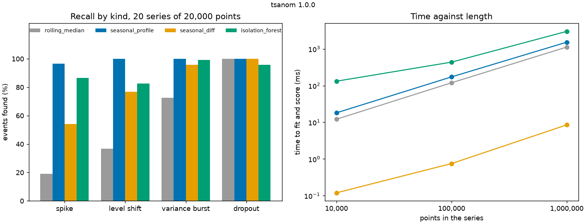

# tsanom: four anomaly detectors for time series, compared on known anomalies

[](https://github.com/TexAlphaWolf/ana-timeseries-anomalies/actions/workflows/ci.yml)
[](https://github.com/TexAlphaWolf/ana-timeseries-anomalies/actions/workflows/codeql.yml)


Four ways to find anomalies in a metric (a rolling median, a seasonal profile, a seasonal difference and an isolation
forest), run on generated series in which **every anomaly was injected at a known place**, so the answer is not a matter of
opinion: each method is scored on how many injected events it finds, how many false alarms it raises and how well it ranks
the points. It is a command line tool (`tsanom`) with tests, a Docker image and a report generated from the measured numbers.



## What the numbers say

All figures are from one run in Docker on Linux x86_64 with 12 CPUs, Python 3.14.10, NumPy 2.5.4 and scikit-learn 1.9.1
([`docs/bench.json`](docs/bench.json); 20 series of 20,000 points, 480 injected events, seed 1; timings are the median of
5 runs). Every method uses the same threshold rule: the largest score seen on the clean start of the series.

1. **The seasonal profile finds 476 of the 480 events (99.2%)**, with a precision of 93.0% and 2.40 false alarms per
   10,000 points. It is the only one that finds nearly every spike (116 of 120) and every level shift (120 of 120).
2. **Ignoring the daily cycle hides the small anomalies.** The rolling median finds 57.1% of the events: 23 of 120 spikes
   (19.2%) and 44 of 120 level shifts (36.7%), because the cycle swings the series by about 14 units either way and a
   spike of 10 to 20 units hides in it. It finds all 120 dropouts, which fall by about 100.
3. **Comparing with the same moment one period earlier raises many false alarms**: 28.53 per 10,000 points, 11.9 times the
   seasonal profile's, and a precision of 47.4%. It finds 81.7% of the events.
4. **The best ranking is not the best detector.** The isolation forest has the highest ROC AUC (0.970 against 0.909), but
   with the shared threshold it finds 91.0% of the events against 99.2%: how well points are ordered and where a threshold
   falls are different questions.
5. **Cost.** On a series of 1,000,000 points (19 years of one point every ten minutes) fitting and scoring takes
   1,526.8 ms for the seasonal profile, 1,125.1 ms for the rolling median, 3,009.2 ms for the isolation forest and 8.51 ms
   for the seasonal difference, which is a subtraction.

[`docs/analysis.md`](docs/analysis.md) goes through the results and their limits; [`docs/bench.md`](docs/bench.md) is the
generated report.

## Quick start

With Docker (nothing else to install):

```bash
docker build -t tsanom .
docker volume create ts
docker run --rm --user 0 -v ts:/data --entrypoint chown tsanom 10001 /data
RUN="docker run --rm --read-only --tmpfs /tmp --cap-drop ALL --security-opt no-new-privileges --network none -v ts:/data tsanom"
$RUN generate --points 20000 --seed 1 --out /data/demo     # series.csv and events.json
$RUN evaluate /data/demo                                   # score the four detectors
```

With Python 3.11 to 3.14:

```bash
pip install .
tsanom generate --points 20000 --seed 1 --out demo
tsanom evaluate demo
tsanom detect demo/series.csv --method seasonal_profile --figure demo/found.png
```

To use it on your own data, give `detect` a CSV with a `value` column (or one column of numbers), the number of points in
one cycle (`--period`, default 144) and how many points at the start are clean (`--train`, or `--train-fraction`, default
0.25). It prints the anomalous runs and exits 1 if there are any, 0 if there are none, 2 on an error.

## Real output

`tsanom generate --points 20000 --seed 1 --out demo` then `tsanom evaluate demo`:

```text
20,000 points, 24 injected anomalies; learning on the first 5,000
rolling_median: found 16/24 (66.7%), precision 74.4% (10 false alarms), AUC 0.689; spike 1/6, level shift 3/6, variance burst 6/6, dropout 6/6
seasonal_profile: found 24/24 (100.0%), precision 91.7% (5 false alarms), AUC 0.917; spike 6/6, level shift 6/6, variance burst 6/6, dropout 6/6
seasonal_diff: found 18/24 (75.0%), precision 43.3% (51 false alarms), AUC 0.836; spike 3/6, level shift 3/6, variance burst 6/6, dropout 6/6
isolation_forest: found 24/24 (100.0%), precision 77.4% (14 false alarms), AUC 0.957; spike 6/6, level shift 6/6, variance burst 6/6, dropout 6/6
```

## The series and the anomalies

A level of 100, a daily and a weekly cycle, a slight trend and AR(1) noise (standard deviation 2). The first 25% is clean;
in the rest, four kinds of anomaly are injected, each placed at least 400 points from the others: a **spike** (one point,
5 to 10 noise deviations), a **level shift** (20 to 60 points, 4 to 8 deviations), a **variance burst** (20 to 60 points,
3 to 5 times the noise) and a **dropout** (5 to 20 points near zero). `events.json` lists every one. Details in
[`docs/method.md`](docs/method.md).

## Commands

| Command | What it does |
|---|---|
| `tsanom generate --points N --seed S --period P --rate R --out DIR` | A series with injected anomalies: `series.csv` (with an `anomaly` column) and `events.json` |
| `tsanom evaluate DIR [--method M]` | Scores the detectors on a generated series: events found, false alarms, AUC |
| `tsanom detect FILE [--period P] [--train N] [--method M] [--out DIR] [--figure PNG]` | Anomalous runs in a CSV; exit 1 if any |
| `tsanom bench --series 20 --sizes 10000,100000,1000000 --repeat 5 --out DIR` | Quality over many series and time over growing ones |
| `tsanom render FILE.json [--figure PNG]` | Rebuilds the Markdown (and the figure) from `bench.json` |
| `tsanom methods` | Lists the detectors |

## How it is verified

- The generator returns the exact position of every event; tests check that the clean start is clean, that events keep their
  distance, and that the values change only inside events.
- Each detector is compared with a point-by-point reference written from its definition, and a test changes the future of a
  series to check that the score of a point depends only on the points before it.
- The scoring (runs, slack, false alarms) is tested on hand-made flags.
- `tests/test_docs.py` checks that the numbers in this README match `docs/bench.json`.
- CI runs Python 3.11 to 3.14, a 100,000-point run, Windows and macOS, and the Docker end to end (Linux and Windows).

## Where this does not apply

Real metrics have gaps, several cycles, changing noise and anomalies nobody labelled; the ranking here is on a
generated family of series, with anomalies of the sizes listed above. It learns once from a clean start and does not
retrain. See [`docs/limitations.md`](docs/limitations.md).

## Documentation

[Architecture](docs/architecture.md) · [Method](docs/method.md) · [Analysis](docs/analysis.md) ·
[Limitations](docs/limitations.md) · [Benchmark](docs/bench.md) · [Contributing](CONTRIBUTING.md) ·
[Security](SECURITY.md) · [Changelog](CHANGELOG.md)

## Licence

MIT, Luca Tessitore.
